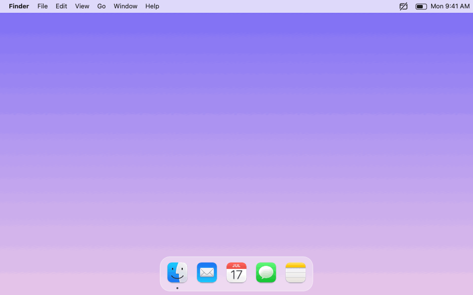
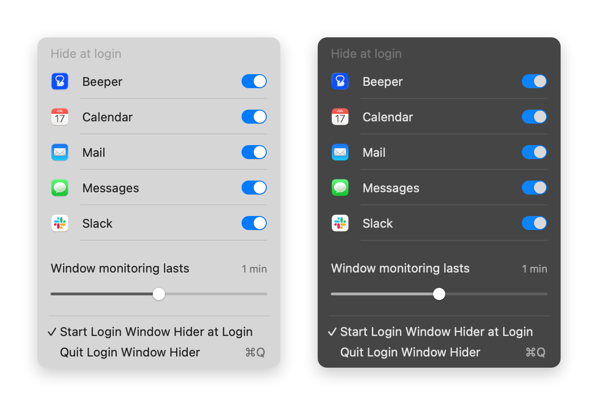

<p align="center">
  
</p>

<h1 align="center">Login Window Hider</h1>

<p align="center">
  A tiny macOS menu bar app that keeps the apps you open at login running, but out of sight.
</p>

<p align="center">
  <a href="https://github.com/Laser-Love/login-window-hider/releases/latest/download/Login-Window-Hider.dmg">
    
  </a>
</p>

<p align="center">
  macOS 13 Ventura or later · Apple Silicon and Intel · Free and open source
</p>

<p align="center">
  
</p>

---

## Why

When you log in, every app in your Login Items opens its window at once: mail, chat, calendar, music. Older versions of macOS had a **Hide** checkbox for each login item that kept the app running without showing its window. Apple removed it in macOS Ventura.

Login Window Hider brings it back.

## What it does

- **Hides login apps' windows.** A few seconds after you log in, it hides the windows of the apps in **System Settings → General → Login Items → Open at Login**. The apps keep running in the background and stay in the Dock. Click one to bring it back.
- **Only touches login apps.** Anything you open yourself is never hidden. If you click a login app during startup, it stays visible too.
- **Keeps them hidden.** Some apps show their window a little late. For the first minute after login, it hides them again if they reappear on their own.
- **One switch per app.** Click the menu bar icon to see your login apps, then switch off any you'd rather see at login.
- **Stays out of the way.** No Dock icon, no windows, and it does nothing after the first minute.

<p align="center">
  
</p>

## Install

1. **[Download Login-Window-Hider.dmg](https://github.com/Laser-Love/login-window-hider/releases/latest/download/Login-Window-Hider.dmg)**.
2. Open it and drag **Login Window Hider** into **Applications**.
3. Open Login Window Hider from Applications. Its icon (a window with a slash) appears in the menu bar, and it adds itself to your Login Items.

### "Apple could not verify…" warning

Login Window Hider isn't signed with a paid Apple Developer certificate, so the first time you open it, macOS blocks it. To allow it:

- **macOS 15 Sequoia and later:** open the app once and click **Done** on the warning. Then go to **System Settings → Privacy & Security**, scroll down to the message about Login Window Hider, and click **Open Anyway**.
- **macOS 13 and 14:** right-click the app in Applications, choose **Open**, then click **Open** again.

You only need to do this once.

### Permission to read your Login Items

The first time it runs, macOS asks: **"Login Window Hider wants to control System Events."** Click **OK**. That's how it reads your Open at Login list. It doesn't use this access for anything else.

## Using it

- **Click the menu bar icon** to see your login apps. Switch an app **on** to hide it at login, or **off** to leave it alone.
- **Add or remove login apps** in System Settings → General → Login Items. The menu picks up changes the next time you open it.
- **Bring a hidden app back** by clicking it in the Dock or switching to it with ⌘-Tab.
- **Turn off Start at Login** or **Quit** from the bottom of the menu.

## How it works

- At login it reads the **Open at Login** list from System Events and skips menu bar and background-only apps, since they have no windows.
- It waits **5 seconds** so login can settle, then hides each listed app with the standard macOS "Hide" (the same as pressing ⌘H in that app).
- Until **1 minute** after login, it checks twice a second and hides any listed app that has shown itself again.
- If a login app comes forward right after you click or type (Dock, ⌘-Tab, Spotlight or its window), it counts as yours and is left alone. It finds out when you last clicked or typed from macOS's input-timing information, which doesn't include anything you type or click on.
- Apps that start through their own helper instead of Open at Login (for example Spotify or 1Password) aren't in the list.

## Privacy

Login Window Hider has no network access, analytics or accounts. It reads only your Login Items list and the list of running apps, and it stores your on/off switches locally on your Mac.

## Uninstall

1. Click the menu bar icon and choose **Quit Login Window Hider**.
2. Delete **Login Window Hider** from Applications.
3. If it still appears in System Settings → General → Login Items, select it and click **−**.

## Build from source

You need macOS 13 or later and Apple's Command Line Tools (`xcode-select --install`). Full Xcode isn't required.

```bash
git clone https://github.com/Laser-Love/login-window-hider.git
cd login-window-hider
sh build.sh install     # build, copy to /Applications and open
sh make_dmg.sh          # build the downloadable dist/Login-Window-Hider.dmg
```

To try the startup behavior without logging out:

```bash
LOGINHIDER_FORCE_STARTUP=1 "build/Login Window Hider.app/Contents/MacOS/LoginWindowHider"
```

| File | What it is |
| --- | --- |
| `Sources/main.swift` | The whole app (AppKit, no Xcode project) |
| `Icon/make_icon.swift` | Draws the app icon |
| `Info.plist` | App settings |
| `build.sh` | Builds a universal app (Apple Silicon and Intel) |
| `make_dmg.sh` | Packages the app as a .dmg |
| `docs/demo/make_demo.sh` | Renders the animated demo at the top of this page |

## Credits

Designed and made by **[Alex Olmsted](https://alexolmsted.com)**.

## License

[MIT](LICENSE) © 2026 Alex Olmsted
